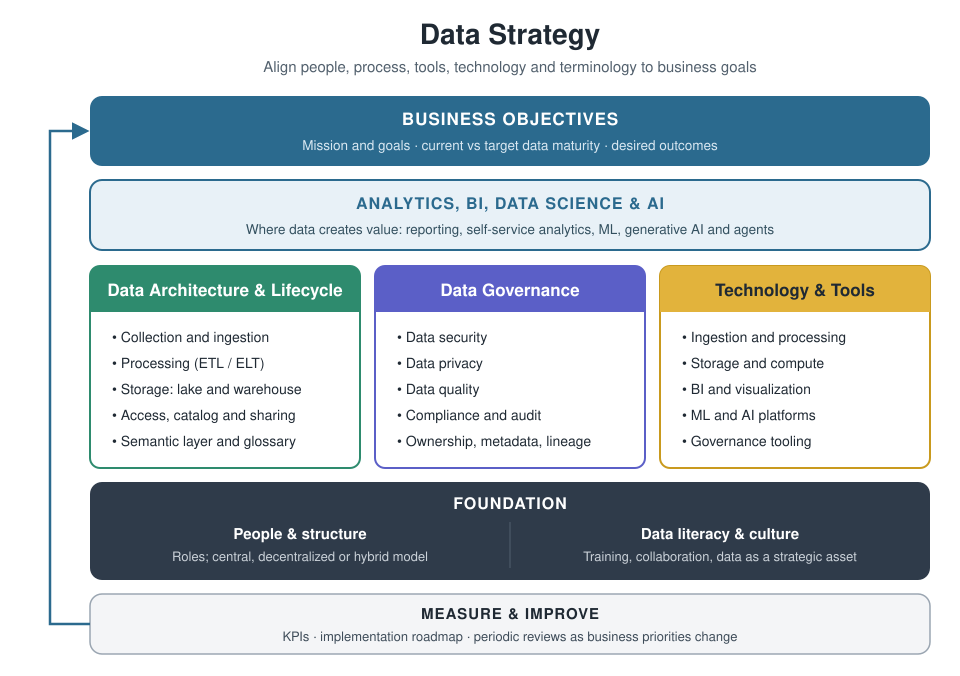

# Data Strategy

[← Overview](../README.md)

A data strategy is the long-term plan that connects an organization's business goals to the people, processes, architecture, governance and technology needed to turn data into decisions, products and AI. [Data governance](../README.md#what-is-data-governance) is one part of it.

## Introduction

Over the years I moved from building ETL pipelines to designing data warehouses, and then to setting up data lakes. Working on data lakes made me think more deeply about overall data architecture and how everything fits together.

When I later wrote a data strategy document, data architecture turned out to be just one part of the bigger picture. Writing it forced some fundamental questions, not only about technology but about how data supports business goals. Rather than rely only on experience and intuition, I cross-checked against several industry references to see what areas they cover. This page captures that approach, the key points, and the references.

## The essence in one line

> **Establish a trusted, data-driven culture by aligning business goals with analytics, data science and AI, supported by strong data governance and scalable infrastructure. Everything else is about aligning people, processes, tools, technology and terminology.**

A successful data strategy starts with a deep understanding of the business's data needs and of the data its business processes generate. That means mapping business processes to the software applications that automate them, so the right data is captured at the source.

At its core, the strategy is to deliver **high-quality data that accurately reflects real-world business activity**: timely, centralized and readily accessible to every persona in the organization (data scientists, business intelligence engineers, business analysts and others). The right data governance processes make sure of data quality, timeliness, access permissions and privacy compliance.

## The framework

The framework reads top to bottom: business objectives decide what value to create; analytics, BI, data science and AI are where value is created; three capability pillars deliver it; people and culture make it possible; and measurement feeds back into the objectives.

| Layer | Components | Key questions |
| --- | --- | --- |
| Business objectives | Mission, goals, current vs target maturity, desired outcomes | Which business goals must data support, and how will we know? |
| Analytics, BI, data science & AI | Reporting, self-service analytics, ML, generative AI and agents | Which use cases create value, and in what order? |
| Data architecture & lifecycle | Collection, processing, storage, access and sharing, semantic layer | How does data flow from source to consumer? |
| Data governance | Security, privacy, quality, compliance, ownership, metadata | Can the data be trusted, protected and audited? |
| Technology & tools | Ingestion, storage, processing, BI, ML/AI, governance tooling | Which tools, evaluated on business need, scale and compliance? |
| Foundation | People and structure; data literacy and culture | Who does the work, and do people know how to use data? |
| Measure & improve | KPIs, roadmap, periodic reviews | Is the strategy delivering, and what should change? |

## Components in detail

### 1. Mission and objectives (business goals)

- Define how data supports tracking business goals, such as revenue growth, customer satisfaction and innovation.
- Assess where the organization stands today and clarify the path to a data-driven culture. A typical maturity scale:

  | Stage | Typical state |
  | --- | --- |
  | 1. Siloed | Data locked in applications and spreadsheets |
  | 2. Descriptive | Operational reporting and dashboards |
  | 3. Diagnostic | Self-service analytics across domains |
  | 4. Predictive | ML models in production |
  | 5. Prescriptive / AI-driven | Recommendations, automation, AI agents acting on data |

- Clarify desired outcomes: operational efficiency, faster decision-making, AI/ML enablement.

### 2. People and structure

- Define data roles and responsibilities: data engineers, data scientists, BIEs, analysts, data stewards, data product owners.
- Choose an operating model that fits the business:

  | Model | How it works | Fits when |
  | --- | --- | --- |
  | Centralized | One central data team builds and owns the platform and datasets | Smaller organizations, early maturity, strong need for consistency |
  | Decentralized | Each domain team owns its own data end to end | Highly autonomous domains with strong engineering |
  | Hybrid (federated) | Central platform and standards; domains own their data products | Most large organizations; the basis of data mesh |

### 3. Data literacy and culture

- Plan data education and literacy programs across teams.
- Encourage cross-functional data collaboration.
- Build a culture that treats data as a strategic asset.

### 4. Data lifecycle capabilities

**Data collection**

- Identify internal and external data sources.
- Map business processes to the applications that automate them, so the right data is captured at the source.
- Choose ingestion mechanisms and tools based on source type, frequency and latency needs.
- Plan real-time ingestion where use cases require it (operational dashboards, fraud detection, personalization).

**Data processing and transformation**

- Define ETL/ELT processes and tooling.
- Standardize data preparation.

**Data storage and architecture**

- Architect scalable storage and compute (data lakes, data warehouses).
- Balance performance, cost and security.

**Data access and sharing**

- Implement data cataloging and discovery.
- Provide self-service access tools for every persona.
- Define a **semantic layer and business glossary**, so metrics and terms mean the same thing in every report, notebook and AI agent. This is the "terminology" in the one-liner.

### 5. Data governance and compliance

Covered in depth in the rest of this repository:

- [Data security](../01-data-security/README.md): access controls and sharing policies.
- [Data privacy](../02-data-privacy/README.md): compliance with privacy and data protection regulations (GDPR, HIPAA and others).
- [Data quality](../04-data-quality/README.md): data quality standards, monitoring and scoring.
- [Compliance](../03-compliance/README.md): proving the above to regulators, auditors and customers.
- [Governance foundation](../README.md#governance-foundation): ownership, stewardship, metadata management and lineage.

### 6. Analytics and AI/ML enablement

- Outline how the platform supports AI and ML use cases alongside analytics (monetizing data).
- Define AI/ML readiness: feature stores, MLOps, responsible and ethical AI practices, ML governance.
- For generative AI and agents: governed access to unstructured data, metadata rich enough for text-to-SQL and retrieval, and evaluation of AI outputs against trusted data.

### 7. Tools and technology

- List current and planned tools for ingestion, storage, processing, analytics, visualization, AI/ML and governance.
- Evaluate them on business need, scalability, cost and compliance (see the [DQ tool evaluation](../04-data-quality/08-tools-and-evaluation.md) for an example matrix).

### 8. Review and improvement plan

- Set KPIs and metrics to measure success, for example:
  - share of key datasets meeting their DQ standard,
  - data freshness against SLA,
  - time from data request to access,
  - number of active self-service users,
  - use cases in production and the business value they deliver.
- Create an implementation roadmap, phased by business priority and dependencies.
- Review periodically and adapt the strategy as business needs and priorities change.

## Data collection and processing approach

1. **Ingest into the data lake first** for flexible, large-scale storage of raw data.
2. **Move curated, structured data into the data warehouse** for high-performance analytics and standardized reporting.
3. **Close the loop:** bring curated data from the warehouse back into the lake, so advanced analytics, data science and self-service exploration work from the same trusted data.

The end goal is a connected, efficient and democratized data ecosystem, with self-service data access tools, that enables faster, smarter decisions and unlocks new business value.

> **Note on convergence.** Open table formats (such as Apache Iceberg) and lakehouse engines increasingly let the lake and warehouse share one copy of curated data, which reduces the need to move data back and forth in step 3.

## Strategy vs governance vs management

| | Data strategy | Data governance | Data management |
| --- | --- | --- | --- |
| Answers | Why and what: which business goals data serves | Who decides and how: decision rights and accountability | How: day-to-day execution |
| Horizon | Multi-year, reviewed periodically | Ongoing | Daily operations |
| Examples | Target maturity, priority use cases, operating model, roadmap | Ownership, policies, standards, compliance | Pipelines, storage, access provisioning, DQ checks |

## References

These industry references were used to cross-check the areas a data strategy should cover:

- [AWS — What is a data strategy?](https://aws.amazon.com/what-is/data-strategy/)
- [AWS Prescriptive Guidance — Creating a data strategy on AWS](https://docs.aws.amazon.com/prescriptive-guidance/latest/strategy-aws-data/introduction.html)
- [AWS — Modern data strategy (Architectural patterns to build end-to-end data driven applications)](https://docs.aws.amazon.com/whitepapers/latest/build-e2e-data-driven-applications/aws-for-data.html)
- [Google Cloud — Building a data strategy for the AI era](https://cloud.google.com/transform/building-a-data-strategy-for-the-ai-era)
- [Databricks — Data strategy: why it matters and how to build one](https://www.databricks.com/blog/data-strategy-why-it-matters-and-how-build-one)
