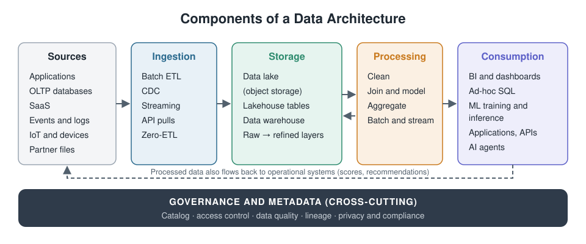
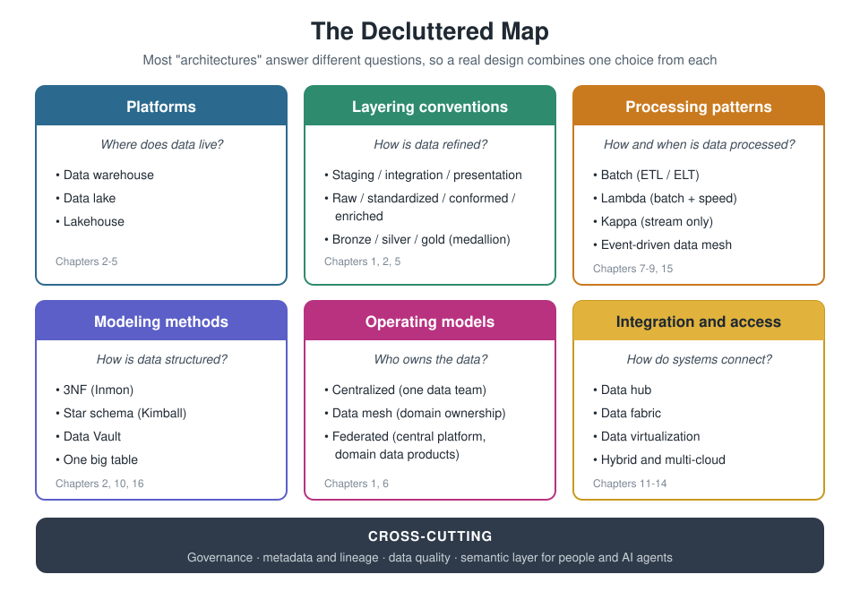

# Data Architecture

[← Overview](../README.md)

Data architecture is the design that decides **where data comes from, where it lives, how it moves and changes, who may use it, and how it is served** to analytics, applications and AI. In the [data strategy framework](../00-data-strategy/README.md) it is one of the three capability pillars, next to data governance and technology. Governance defines the rules; architecture is where those rules are built in.

This page is the summary. The full treatment, chapter by chapter, is in **[Decluttering Data Architectures](https://github.com/rongali-naidu/decluttering-data-architectures)**.

## Components

Whatever the vendor or buzzword, almost every data architecture is assembled from the same parts.

| Component | Role | Examples |
| --- | --- | --- |
| **Sources** | Where data originates | Applications, OLTP databases, SaaS, events and logs, IoT, partner files |
| **Ingestion** | Moves data into the platform, in batch or streaming | Batch ETL, change data capture, streaming, API pulls, zero-ETL |
| **Storage** | Holds data for analysis | Data lake, lakehouse tables, data warehouse |
| **Processing** | Cleans, joins, models and aggregates | Spark, SQL engines, stream processors |
| **Consumption** | Serves people and systems | BI, ad-hoc SQL, ML, applications and APIs, AI agents |
| **Governance and metadata** *(cross-cutting)* | Catalog, access control, quality, lineage, privacy | See the [governance framework](../README.md#the-framework) |

## Layers: one idea, many names

Stored data is refined in layers. Every vendor names them differently, but they are the same steps:

| Purpose | Traditional warehouse | AWS guidance | Databricks medallion |
| --- | --- | --- | --- |
| Land data as received | Staging | Raw | Bronze |
| Validate and standardize | Staging / ODS | Standardized | Silver |
| Integrate into shared business entities | Integration (EDW) | Conformed | Silver |
| Shape for specific uses | Presentation (data marts) | Enriched (data products) | Gold |

Each layer boundary is also where [data quality checks](../04-data-quality/03-where-to-check.md) belong: a layer's name is a promise about quality, and the checks make it true.

## The decluttered map

Most "architectures" are not alternatives to each other. They answer **different questions**, and a real design picks one answer to each.

| Question | Kind of "architecture" | Options |
| --- | --- | --- |
| Where does data live? | Platform | Data warehouse, data lake, lakehouse |
| How is data refined? | Layering convention | Staging/integration/presentation; raw/standardized/conformed/enriched; bronze/silver/gold |
| How and when is it processed? | Processing pattern | Batch, Lambda, Kappa, event-driven |
| How is it structured? | Modeling method | 3NF (Inmon), star schema (Kimball), Data Vault, one big table |
| Who owns it? | Operating model | Centralized, data mesh, federated |
| How do systems connect? | Integration and access | Data hub, data fabric, data virtualization, hybrid and multi-cloud |

The [decluttered map chapter](https://github.com/rongali-naidu/decluttering-data-architectures/blob/main/docs/17-decluttered-map.md) works through an example design and questions to choose by.

## Architecture principles

The principles I apply regardless of platform:

| Principle | What it means in practice |
| --- | --- |
| **Business needs first** | Start from the consumers and use cases in the data strategy, not from the technology |
| **Separate storage and compute** | Keep data in low-cost, durable storage, and scale engines independently |
| **Open formats, one copy** | Store curated data in open table formats (such as Apache Iceberg) so many engines share one governed copy instead of making copies |
| **Governance by design** | Classification, access control, encryption and lineage are part of the design, not added afterwards |
| **Shift left on quality** | Validate at the source and at every layer boundary, not only at the end |
| **Metadata first** | Every dataset has an owner, a description, a schema contract and lineage. This is the context people and AI agents need |
| **Real time only where it pays** | Default to batch; stream where freshness has business value |
| **Event-driven by default for new systems** | Applications publish data changes as events that serve both integration and analytics (see [Event-Driven Data Mesh](https://github.com/rongali-naidu/decluttering-data-architectures/blob/main/docs/07-event-driven-data-mesh.md)) |
| **Design for change and cost** | Expect schemas, sources and services to change; measure cost per workload |

## How architecture implements governance

Each governance pillar is enforced through architecture choices. On AWS, for example:

| Governance pillar | Architecture mechanism | AWS example |
| --- | --- | --- |
| [Data security](../01-data-security/README.md) | Fine-grained access control, encryption, network isolation, audit logs | AWS Lake Formation, AWS KMS, AWS CloudTrail |
| [Data privacy](../02-data-privacy/README.md) | PII classification, masking, row-level deletes, retention rules | Amazon Macie, Lake Formation column and row filters, Iceberg deletes |
| [Data quality](../04-data-quality/README.md) | Checks between layers, write-audit-publish, monitoring | AWS Glue Data Quality, Deequ |
| [Compliance](../03-compliance/README.md) | Lineage, audit trails, data residency by region | Catalog lineage, CloudTrail, region-scoped storage |
| [Foundation](../README.md#governance-foundation) | Central catalog, ownership metadata, business glossary | AWS Glue Data Catalog, Amazon SageMaker Catalog |

## Documenting decisions

Record significant architecture choices as short **architecture decision records (ADRs)**, so the reasoning survives team changes:

| Field | Content |
| --- | --- |
| **Context** | The problem and constraints (volume, latency, cost, compliance) |
| **Options considered** | Two or three realistic alternatives |
| **Decision** | What was chosen |
| **Consequences** | Trade-offs accepted, and what would make you revisit the decision |

## Further reading

- [Decluttering Data Architectures](https://github.com/rongali-naidu/decluttering-data-architectures): terminology, warehouses, lakes and lakehouses, AWS and Databricks, data mesh, Lambda and Kappa, Data Vault, hybrid, fabric, hub, virtualization, pipeline patterns, and modeling and storage.
