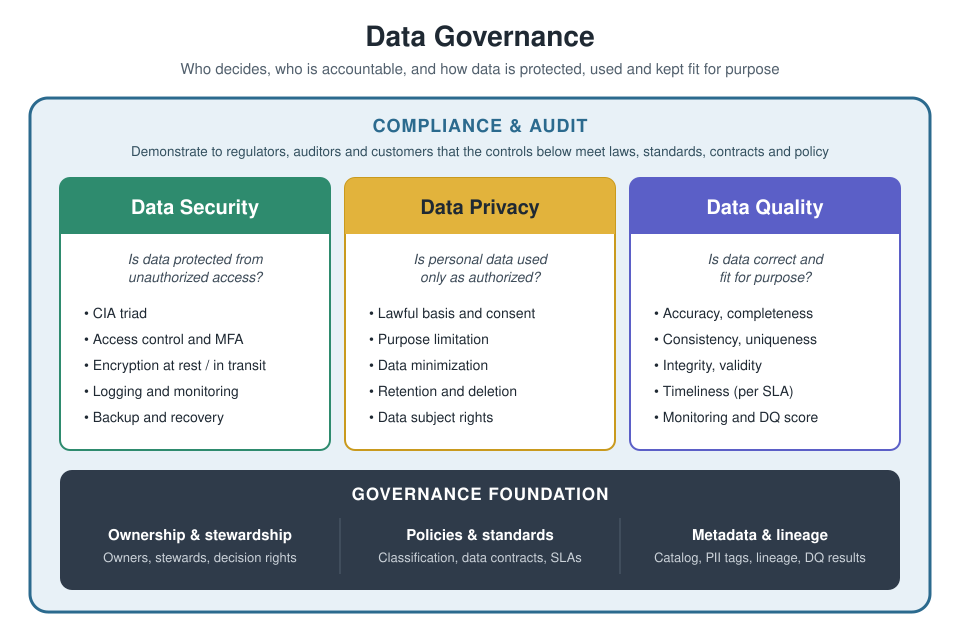

# Data Governance

Notes on data governance: what it is, the three pillars it governs (**data security, data privacy and data quality**), the compliance layer that proves those pillars work, and the foundation they all rest on.

Data governance is one part of a broader **[data strategy](00-data-strategy/README.md)**, which connects business goals to people, architecture, governance and technology. Start there for the bigger picture.



## What is data governance?

Data governance is the system of **decision rights and accountability** for an organization's data: who owns each dataset, who may decide how it is protected and used, which policies and standards apply, and how issues are escalated and resolved.

The pillars below are *what* governance governs. Governance itself is *who decides and how*.

## The framework

### Three pillars

As organizations rely more on data to drive decisions, products and services, each pillar addresses a different risk dimension of data management.

| Pillar | Question it answers | Focus |
| --- | --- | --- |
| [Data Security](01-data-security/README.md) | Is data protected from unauthorized access, change or loss? | Confidentiality, integrity and availability (CIA triad) through access control, encryption and monitoring |
| [Data Privacy](02-data-privacy/README.md) | Is personal data used only as authorized? | Lawful basis, purpose limitation, minimization, retention and individual rights |
| [Data Quality](04-data-quality/README.md) | Is data correct and fit for purpose? | Accuracy, completeness, consistency, uniqueness, integrity, validity and timeliness |

### Compliance and audit: the outer layer

[Compliance](03-compliance/README.md) is not a peer of the pillars; it wraps all three. It is the ability to demonstrate to regulators, auditors, partners and customers that security, privacy **and quality** controls meet external and internal obligations: laws (GDPR, HIPAA, SOX), industry standards and contracts (PCI DSS), attestations (SOC 2, ISO 27001) and internal policy.

Quality belongs inside the compliance boundary too. SOX, for example, is largely about the accuracy and integrity of financial data.

### Governance foundation

All three pillars depend on the same foundation:

| Foundation element | What it provides | Why the pillars need it |
| --- | --- | --- |
| Ownership and stewardship | Owners, stewards and decision rights for each dataset | Someone is accountable for every access decision, privacy request and quality issue |
| Policies and standards | Data classification, data contracts, SLAs | Security rules follow classification; quality rules follow data contracts |
| Metadata and lineage | Catalog, PII and classification tags, lineage, DQ results | Security needs classification tags, privacy needs PII tags and lineage to honor deletion requests, compliance needs lineage for audit trails, and quality needs rules and results attached to datasets |

## The bigger picture

- **Privacy** defines what can be done with data.
- **Security** enforces those rules through technical controls.
- **Quality** ensures the data is correct and fit for purpose: the "value layer".
- **Compliance** provides the framework and accountability for all three, and proves they work.
- **The foundation** (ownership, policies, metadata) makes every pillar possible to operate and audit.

> **Note on data protection.** Data protection is not a separate pillar. It is the operational outcome of applying data security controls to enforce data privacy requirements and comply with the relevant data protection regulations and laws.

> **Note on overlapping terms.** *Integrity* and *availability* appear in both the security CIA triad and data quality, with different meanings. In security, integrity means data is not tampered with and availability means systems and data are accessible. In data quality, integrity means relationships between entities hold, and the delivery dimension is called **timeliness** (data arrives per SLA) to avoid the collision.

## Repository structure

```
data-governance/
├── README.md                     # This overview
├── images/                       # Framework diagrams (SVG + PNG)
├── 00-data-strategy/             # Data strategy: essence, framework, components, references
├── 01-data-security/             # CIA triad, mechanisms, encryption, security policy
├── 02-data-privacy/              # Privacy principles, security vs privacy, privacy policy
├── 03-compliance/                # Obligations, key regulations, audits
└── 04-data-quality/              # Dimensions, DQ frameworks, profiling, scoring, ownership, tools
```

## License

This work is licensed under [CC BY 4.0](https://creativecommons.org/licenses/by/4.0/). You may share and adapt it with attribution. See [LICENSE](LICENSE).
