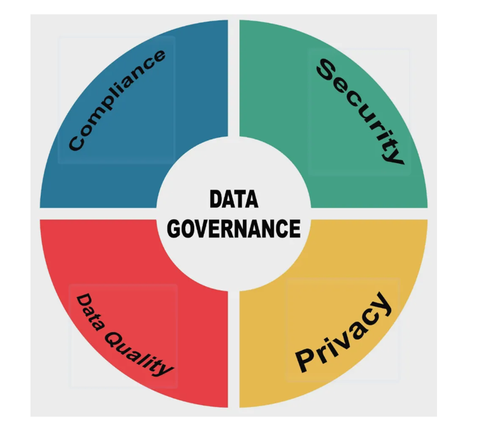

# Data Governance

Notes on data governance and its four pillars: **data security, data privacy, regulatory compliance and data quality**.



## Overview

As organizations rely more on data to drive decisions, products and services, four terms come up again and again in technical and governance discussions: data security, data privacy, regulatory compliance and data quality. They are related, but each addresses a different risk dimension of data management. Together they form the four pillars of effective data governance.

| Pillar | Question it answers | Focus |
| --- | --- | --- |
| [Data Security](01-data-security/README.md) | Is the data protected from unauthorized access, change or loss? | Confidentiality, integrity and availability (CIA triad) through access control, encryption and monitoring |
| [Data Privacy](02-data-privacy/README.md) | Is personal data used only as authorized? | Lawful collection, purpose limitation, minimization, retention and individual rights |
| [Compliance](03-compliance/README.md) | Can we prove our practices meet the law? | Mapping security and privacy controls to regulations and demonstrating them to auditors |
| [Data Quality](04-data-quality/README.md) | Is the data correct and fit for purpose? | Accuracy, completeness, consistency, uniqueness, integrity, validity and timeliness |

## The bigger picture

- **Privacy** defines what can be done with data.
- **Security** enforces those rules through technical controls.
- **Compliance** with regulations and laws provides the framework and accountability for both.
- **Data quality** ensures the data is useful, correct and properly formatted: the "value layer".

> **Note on data protection.** Data protection is not a separate pillar. It is the operational outcome of applying data security controls to enforce data privacy requirements and comply with the relevant data protection regulations and laws.

## Repository structure

```
data-governance/
├── README.md                     # This overview
├── images/
├── 01-data-security/             # CIA triad, mechanisms, encryption, security policy
├── 02-data-privacy/              # Privacy principles, security vs privacy, privacy policy
├── 03-compliance/                # Regulatory requirements, key regulations, audits
└── 04-data-quality/              # Dimensions, DQ frameworks, profiling, scoring, ownership, tools
```

## License

This work is licensed under [CC BY 4.0](https://creativecommons.org/licenses/by/4.0/). You may share and adapt it with attribution. See [LICENSE](LICENSE).
